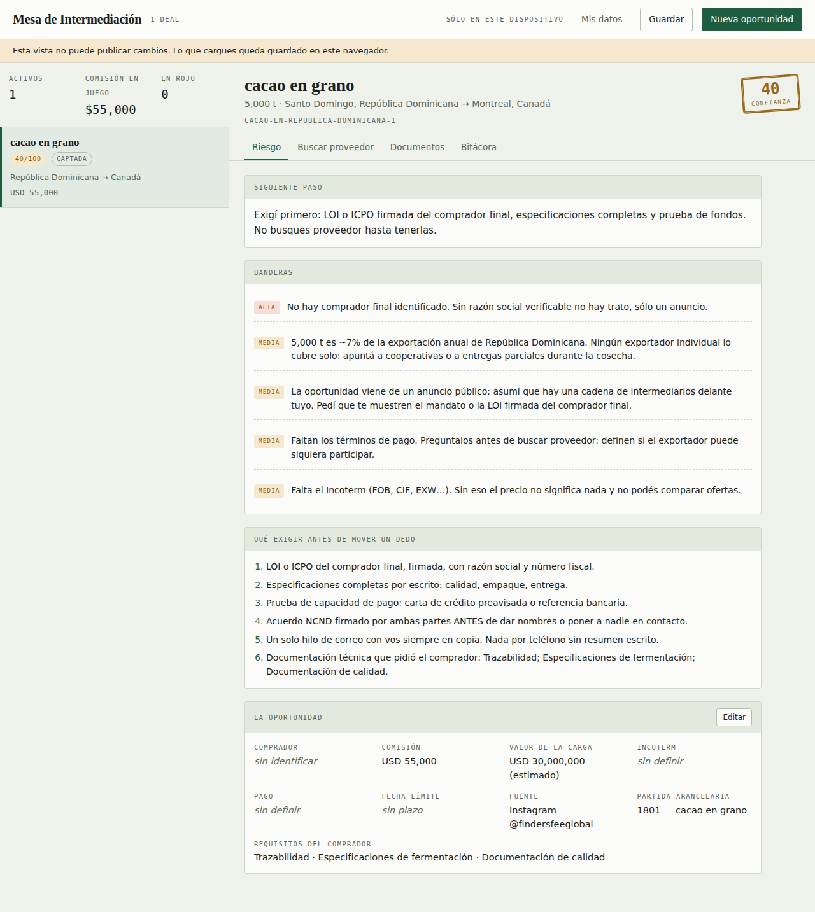

# Mesa de Intermediación

App de una sola página para trabajar oportunidades de *finder's fee*: esos
anuncios de "te pago X si me conectas con un exportador de Y". La mayoría no
llega a nada, así que la app existe para que descubras cuáles antes de meterles
semanas de trabajo, y para que en las que sí valen no te saquen del trato.

## Qué hace

**1. Lee el anuncio.** Copiás el post y lo pegás; la app saca producto,
cantidad, países, ciudades, comisión y requisitos, en inglés o en español, con
emojis y todo. El post de cacao dominicano de Instagram sale con nueve campos
llenos de un solo pegado. Lo que no reconoce lo cargás a mano, y el texto
original queda guardado en el deal.

**2. Filtra la oportunidad.** Sale una nota de 0 a 100 con las banderas rojas
concretas. El rubro revisa:

- La comisión contra el valor real de la carga. Más del 5% no existe en
  commodities: significa que el volumen o el precio del anuncio es inventado.
- El volumen contra lo que ese país exporta al año. 5.000 t de cacao dominicano
  son ~7% de la exportación nacional: ningún exportador individual lo cubre solo.
- Jerga de cadena de fraude en los términos de pago (SBLC, BG, MT103, POF,
  instrumentos "en leasing"). Eso es salida inmediata.
- Cualquier pago por adelantado. Un intermediario cobra al cierre, nunca paga
  por entrar.
- Si vas a presentar sin acuerdo firmado, que es exactamente como te brincan.

**3. Te dice dónde buscar y dónde verificar.** Dos cosas distintas: gremios y
agencias de promoción para *encontrar* al exportador, y registros oficiales
—registro fiscal, mercantil, aduanas— para confirmar que existe de verdad.
Más consultas de buscador armadas con los datos del deal.

**4. Genera los documentos.** Acuerdo NCND con cláusula de no elusión y
comisión, checklist de qué papeles exigirle al proveedor, y los mensajes de
primer contacto: uno en español para el exportador, uno en inglés para quien
publicó el anuncio. Los cinco salen juntos en un solo archivo con **Copiar
todo** o **Descargar .md**.

Y salen **con membrete**: cada documento y el expediente completo se bajan como
una hoja con el sello de la empresa, los datos de contacto, la fecha y la línea
de confidencialidad, con márgenes de carta y las rayas para firmar donde van. Se
abre en el navegador y se guarda en PDF desde ahí, sin instalar nada. Un NCND en
texto plano se lee como un favor entre conocidos; el mismo texto en papel con
membrete se lee como una empresa, y es lo que te mandan firmado de vuelta.

**5. Lleva la bitácora.** Etapa del embudo, siguiente paso concreto y las notas
de cada llamada. Esa bitácora es la prueba de que vos originaste el contacto.

**6. Aguanta el volumen que el plan pide.** Pegás una lista y salen todas las
fichas de una (saltando las que ya tenías), buscás entre ellas por nombre, país
o producto, y cada ficha lleva fecha de *volver a contactar* con aviso cuando se
vence. Y el libro entero se exporta a un archivo JSON que podés volver a cargar:
tu activo deja de vivir en un solo lugar.

**7. Acumula el libro de dos lados.** Compradores y proveedores fichados por
separado, cada uno con su ficha, su capacidad, sus certificaciones y su estado
de verificación. La app cruza los dos lados sola y te dice quién encaja con
quién y qué le falta: *"cubre el volumen completo, tiene las certificaciones,
ya exportó a Canadá"* contra *"sólo cubre 18%, le falta Fairtrade"*. Un deal
suelto se pierde; el libro queda. Y cuando abrís una oportunidad nueva, los
proveedores de tu libro que sirven ya aparecen ahí.

**8. Le escribe a cada ficha por el canal que conviene.** La pestaña
*Escribir* arma el mensaje con los campos de la ficha y los tuyos, y lo abre
directo: WhatsApp con el número ya normalizado, o el correo con asunto y cuerpo
puestos. Son cuatro mensajes distintos, no uno traducido: corto para WhatsApp,
formal para correo, y uno por cada lado del libro. La app marca cuál conviene —
WhatsApp con exportadores y cooperativas, correo con un departamento de compras
— y al mandarlo deja la nota y te recuerda el seguimiento a los siete días.

**9. Presenta a las dos partes.** Desde cualquier cruce, un botón arma el
correo de presentación: quién es cada uno, qué verificaste del proveedor, y el
pedido de quedarte en copia. Con un candado: no deja registrar la presentación
hasta que las dos partes tengan el NCND firmado, porque presentar antes de eso
es la forma número uno de quedarse afuera del trato. Al mandarlo queda anotado
en la bitácora de los dos, con fecha.

**10. Sigue una secuencia, no un recordatorio suelto.** Día 0, 3, 7, 14 y 30,
con un mensaje distinto en cada paso: el rebote corto, el que trae un dato
nuevo, el que pide hablar con otra persona, y el cierre cortés —que es el que
más respuestas destraba—. Cada vez que mandás uno, avanza sola y agenda el
siguiente.

**11. Revisa tu correo y te dice quién contestó.** Un botón consulta Gmail con
las credenciales de quien mira la página, en una sola búsqueda por los dominios
del libro, y marca las fichas que respondieron. Si Gmail no está conectado, si
la sesión venció o si falta permiso, cada caso dice qué hacer en vez de un
"algo salió mal".

**12. Lee personas, no sólo anuncios.** Pegás una firma de correo, una tarjeta
o un perfil de LinkedIn y sale la ficha con nombre, empresa, cargo, teléfono y
correo separados.

**13. Escribe los anuncios.** Lo inverso del lector: de un deal o de la
necesidad de un comprador salen los tres posts listos — Instagram con el formato
de placas, LinkedIn en tono profesional y WhatsApp corto y reenviable, en
español o en inglés. La comisión que se publica no es la tuya: es la tajada que
le pagás a quien te traiga el exportador, y la app la sugiere con una escala que
baja cuando la carga sube (3% en cargas chicas, 0,25% arriba de veinte
millones), porque nadie paga 2% sobre treinta millones.

**14. Te dice en qué estás fallando.** La pestaña **Panel** es el tablero del
negocio, no un adorno:

- **El embudo**: fichados → contactados → respondieron → activos, con la caída
  entre cada etapa. El manual dice que de cuarenta correos salen tres a cinco
  conversaciones (8% a 12%). Abajo del embudo la app te dice si estás en ese
  rango, por debajo, o si todavía no tenés muestra para sacar conclusiones, que
  son tres problemas con arreglos opuestos.
- **Qué paso destraba la respuesta**: de los cinco de la secuencia, cuál trajo
  cada contestación. Si la mayoría contesta recién en el día 14, el mensaje de
  apertura está de más y te ahorrás dos semanas por contacto.
- **Qué canal rinde**: tasa de respuesta por origen de la ficha, para insistir
  donde contestan y no donde más fichas conseguiste.
- **Cuánto tardan en contestar**: mediana, mínimo y máximo de días.
- **El libro de comisiones**: en juego, facturado, cobrado y perdido. Lo que
  cuenta como ingreso es la columna de cobrado, no lo pactado, y si una factura
  pasa de 30 días sin cobrar te lo dice en rojo con el nombre del trato. Una
  correduría sin registro de cobros no es un negocio: es una lista de gente a la
  que le hiciste el favor.

Las fechas que alimentan todo esto se anotan solas: cuándo fue el primer
contacto, cuándo respondió y en qué paso de la secuencia iba.

Ese libro es el activo real del negocio. Un comprador con mandato firmado es lo
escaso: proveedores se consiguen en una tarde, compradores con plata y una LOI
no. Por eso los dos lados se fichan aparte y el comprador tiene su campo de
mandato.

## Cómo se usa

Es un archivo HTML sin dependencias ni servidor. Dos formas:

- **Publicada como Artifact en Claude** (así se usa hoy): guarda los deals
  publicando una versión nueva de sí misma, así que los ves desde cualquier
  dispositivo con el mismo enlace. El botón **Guardar** es el que sube los
  cambios; mientras tanto quedan en el navegador.
- **Local**: abrí `index.html` en el navegador. Todo funciona igual salvo el
  guardado en la nube: los deals quedan en el `localStorage` de esa máquina.

## Los dos documentos

Van aparte de la app porque se leen, no se operan.

`plan/primer-comprador.html` — **el plan de arranque.** De dónde salen los
compradores con mandato real (los registros de importación primero, los grupos
de WhatsApp último), qué es un mandato de verdad, cuánto se cobra por tipo de
mercancía, dos guiones de contacto y un plan de treinta días. Sin un comprador
real, el resto gira en el aire.

`plan/corredor-sd-sju.html` — **el corredor elegido.** Operando desde Puerto
Rico: las cuatro ventajas estructurales de esa base (la Jones Act no aplica a la
carga de origen extranjero que entra directo, territorio aduanero y bancario
estadounidense, Santo Domingo a media hora de vuelo, y ser bilingüe de verdad),
los exportadores dominicanos y los distribuidores puertorriqueños con nombre y
apellido, dónde verificar a cada lado, y las cinco acciones de la primera
semana. Los datos están fechados y con fuentes.

`plan/anatomia-de-un-trato.html` — **el manual del oficio.** Las nueve etapas de
una operación con carta de crédito, con las cuatro donde de verdad se mueren los
tratos; quién es quién y por qué nunca firmás el contrato de compraventa; las
cuatro formas de instrumentar tu comisión y cuál es la que cobra; los Incoterms
que importan y los dos malentendidos que cuestan plata; el embudo y los tiempos
reales; y por qué conviene especializarse en un corredor.

## El aviso que importa

El acuerdo NCND es una plantilla de trabajo, no asesoría legal. Antes de firmar
el primero, que lo lea un abogado de tu jurisdicción; las cláusulas a ajustar
son la de comisión y la de ley aplicable. Después ya lo reusás.

Los precios de referencia y las capacidades de exportación por país son órdenes
de magnitud para detectar disparates, no cifras oficiales. Si el número te
importa, cargá el precio real en el deal.

## Estructura

Todo vive en `index.html`, separado en bloques con `id`:

| Bloque   | Qué tiene                                                        |
|----------|------------------------------------------------------------------|
| `css`    | Tokens de color para tema claro y oscuro, y los componentes.     |
| `app`    | Banderas rojas, directorio, libro de contactos y motor de cruce. |
| `docs`   | Las plantillas: NCND, checklist y mensajes.                      |
| `anuncios` | Los generadores de posts y la escala de comisión sugerida.     |
| `mensajes` | Los mensajes de contacto por WhatsApp y correo, y qué canal conviene. |
| `red`    | Presentaciones con su candado, lector de personas y origen de cada contacto. |
| `ui`     | Estado, guardado y utilidades.                                   |
| `vista`  | Render de las pantallas.                                         |
| `eventos`| Modales y manejo de eventos.                                     |

La app se republica a sí misma reconstruyendo el documento desde esos bloques
más el estado en `#estado`, así que **si agregás un `<script>` nuevo tiene que
llevar el atributo `data-src`** o se pierde en el primer guardado.

## Tres pantallas

`index.html` es la Mesa: el escritorio donde filtrás, verificás, cruzás y
generás los papeles. `bolsillo.html` es la versión de teléfono, para una sola
cosa: abrirla, ver a quién toca escribirle hoy y mandarle el mensaje con el
pulgar. Corre la misma secuencia de cinco pasos que la Mesa —los mismos días y
los mismos textos— así que el teléfono nunca le manda de nuevo el mensaje de
apertura a alguien que ya lo recibió, y el seguimiento por correo sube el hilo
con un **Re:** en vez de abrir uno nuevo. Comparten el formato de respaldo, así
que el mismo archivo JSON pasa de una a la otra.

Las dos guardan su estado dentro de la propia página publicada. El repositorio
guarda la plantilla vacía, así que **antes de publicar una desde el repo hay que
pegarle el `#estado` de la versión viva**, o se borra lo trabajado desde el
teléfono.

`boletin.html` es la tercera: lo que una tarea programada escribe cada mañana
sobre el precio del cacao, las empresas del libro, oportunidades publicadas y
cambios en las reglas. La página no sale a buscar nada —una página publicada no
puede— sino que acumula lo que la tarea le agrega. Para agregar una entrada se
lee el JSON de `#entradas`, se pone la nueva primera, se conservan todas las
anteriores y se republica.

## Arranque

`datos/mesa-arranque.json` es el libro de partida del corredor Santo Domingo-San
Juan: seis exportadores dominicanos de cacao y cinco distribuidores
puertorriqueños, con los datos de contacto que se pudieron verificar y una nota
en cada uno sobre cómo encararlo. Se carga desde **Mis datos → Importar
respaldo**. Ojo: importar reemplaza lo que haya cargado, así que exportá antes
si ya tenías libro.

## Pruebas

`pruebas/navegador.mjs` abre la app y los tres planes en Chromium en cada push
(`.github/workflows/ci.yml`). Veintiséis casos: el lector de anuncios, el filtro de
riesgo, el seguimiento por post, el emparejamiento de productos, el alta en
lote, la búsqueda, el recontacto, el respaldo, y las tres fallas que ya se
arreglaron una vez para que no vuelvan.

Correr local: `CHROMIUM_PATH=/ruta/a/chrome node pruebas/navegador.mjs`

## Qué le falta

- La verificación es un checklist manual: la app te dice dónde mirar y lleva la
  cuenta de lo que comprobaste, pero no consulta ningún registro por vos.
- No publica sola: genera el texto, vos lo pegás en la red que sea.
- El seguimiento de respuestas por post es a mano: tocás **Lo publiqué** al
  publicar y **+1** por cada persona que te escribe. La app no lee tus redes.
- El directorio cubre América Latina y España. Para África y Asia caen sólo las
  fuentes globales, que igual sirven: Trade Map te dice quién exporta qué.
- El lector de anuncios acierta con posts que traen etiquetas. Con texto
  corrido ("busco 200 toneladas de cacao de República Dominicana para Holanda
  FOB") saca producto, cantidad, países, Incoterm y comisión, pero no
  ciudades, requisitos ni términos de pago.
