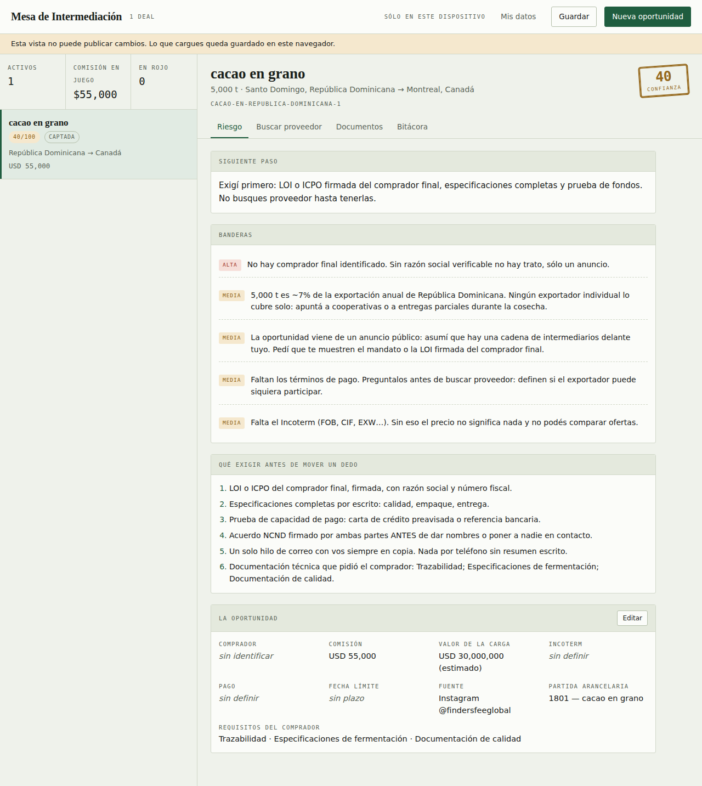

# Mesa de Intermediación

App de una sola página para trabajar oportunidades de *finder's fee*: esos
anuncios de "te pago X si me conectas con un exportador de Y". La mayoría no
llega a nada, así que la app existe para que descubras cuáles antes de meterles
semanas de trabajo, y para que en las que sí valen no te saquen del trato.

## Qué hace

**1. Lee el anuncio.** Copiás el post y lo pegás; la app saca producto,
cantidad, países, ciudades, comisión y requisitos, en inglés o en español, con
emojis y todo. El post de cacao dominicano de Instagram sale con nueve campos
llenos de un solo pegado. Lo que no reconoce lo cargás a mano, y el texto
original queda guardado en el deal.

**2. Filtra la oportunidad.** Sale una nota de 0 a 100 con las banderas rojas
concretas. El rubro revisa:

- La comisión contra el valor real de la carga. Más del 5% no existe en
  commodities: significa que el volumen o el precio del anuncio es inventado.
- El volumen contra lo que ese país exporta al año. 5.000 t de cacao dominicano
  son ~7% de la exportación nacional: ningún exportador individual lo cubre solo.
- Jerga de cadena de fraude en los términos de pago (SBLC, BG, MT103, POF,
  instrumentos "en leasing"). Eso es salida inmediata.
- Cualquier pago por adelantado. Un intermediario cobra al cierre, nunca paga
  por entrar.
- Si vas a presentar sin acuerdo firmado, que es exactamente como te brincan.

**3. Te dice dónde buscar y dónde verificar.** Dos cosas distintas: gremios y
agencias de promoción para *encontrar* al exportador, y registros oficiales
—registro fiscal, mercantil, aduanas— para confirmar que existe de verdad.
Más consultas de buscador armadas con los datos del deal.

**4. Genera los documentos.** Acuerdo NCND con cláusula de no elusión y
comisión, checklist de qué papeles exigirle al proveedor, y los mensajes de
primer contacto: uno en español para el exportador, uno en inglés para quien
publicó el anuncio. Los cinco salen juntos en un solo archivo con **Copiar
todo** o **Descargar .md**.

**5. Lleva la bitácora.** Etapa del embudo, siguiente paso concreto y las notas
de cada llamada. Esa bitácora es la prueba de que vos originaste el contacto.

**6. Acumula el libro de dos lados.** Compradores y proveedores fichados por
separado, cada uno con su ficha, su capacidad, sus certificaciones y su estado
de verificación. La app cruza los dos lados sola y te dice quién encaja con
quién y qué le falta: *"cubre el volumen completo, tiene las certificaciones,
ya exportó a Canadá"* contra *"sólo cubre 18%, le falta Fairtrade"*. Un deal
suelto se pierde; el libro queda. Y cuando abrís una oportunidad nueva, los
proveedores de tu libro que sirven ya aparecen ahí.

**7. Escribe los anuncios.** Lo inverso del lector: de un deal o de la
necesidad de un comprador salen los tres posts listos — Instagram con el formato
de placas, LinkedIn en tono profesional y WhatsApp corto y reenviable, en
español o en inglés. La comisión que se publica no es la tuya: es la tajada que
le pagás a quien te traiga el exportador, y la app la sugiere con una escala que
baja cuando la carga sube (3% en cargas chicas, 0,25% arriba de veinte
millones), porque nadie paga 2% sobre treinta millones.

Ese libro es el activo real del negocio. Un comprador con mandato firmado es lo
escaso: proveedores se consiguen en una tarde, compradores con plata y una LOI
no. Por eso los dos lados se fichan aparte y el comprador tiene su campo de
mandato.

## Cómo se usa

Es un archivo HTML sin dependencias ni servidor. Dos formas:

- **Publicada como Artifact en Claude** (así se usa hoy): guarda los deals
  publicando una versión nueva de sí misma, así que los ves desde cualquier
  dispositivo con el mismo enlace. El botón **Guardar** es el que sube los
  cambios; mientras tanto quedan en el navegador.
- **Local**: abrí `index.html` en el navegador. Todo funciona igual salvo el
  guardado en la nube: los deals quedan en el `localStorage` de esa máquina.

## Los dos documentos

Van aparte de la app porque se leen, no se operan.

`plan/primer-comprador.html` — **el plan de arranque.** De dónde salen los
compradores con mandato real (los registros de importación primero, los grupos
de WhatsApp último), qué es un mandato de verdad, cuánto se cobra por tipo de
mercancía, dos guiones de contacto y un plan de treinta días. Sin un comprador
real, el resto gira en el aire.

`plan/anatomia-de-un-trato.html` — **el manual del oficio.** Las nueve etapas de
una operación con carta de crédito, con las cuatro donde de verdad se mueren los
tratos; quién es quién y por qué nunca firmás el contrato de compraventa; las
cuatro formas de instrumentar tu comisión y cuál es la que cobra; los Incoterms
que importan y los dos malentendidos que cuestan plata; el embudo y los tiempos
reales; y por qué conviene especializarse en un corredor.

## El aviso que importa

El acuerdo NCND es una plantilla de trabajo, no asesoría legal. Antes de firmar
el primero, que lo lea un abogado de tu jurisdicción; las cláusulas a ajustar
son la de comisión y la de ley aplicable. Después ya lo reusás.

Los precios de referencia y las capacidades de exportación por país son órdenes
de magnitud para detectar disparates, no cifras oficiales. Si el número te
importa, cargá el precio real en el deal.

## Estructura

Todo vive en `index.html`, separado en bloques con `id`:

| Bloque   | Qué tiene                                                        |
|----------|------------------------------------------------------------------|
| `css`    | Tokens de color para tema claro y oscuro, y los componentes.     |
| `app`    | Banderas rojas, directorio, libro de contactos y motor de cruce. |
| `docs`   | Las plantillas: NCND, checklist y mensajes.                      |
| `anuncios` | Los generadores de posts y la escala de comisión sugerida.     |
| `ui`     | Estado, guardado y utilidades.                                   |
| `vista`  | Render de las pantallas.                                         |
| `eventos`| Modales y manejo de eventos.                                     |

La app se republica a sí misma reconstruyendo el documento desde esos bloques
más el estado en `#estado`, así que **si agregás un `<script>` nuevo tiene que
llevar el atributo `data-src`** o se pierde en el primer guardado.

## Qué le falta

- La verificación es un checklist manual: la app te dice dónde mirar y lleva la
  cuenta de lo que comprobaste, pero no consulta ningún registro por vos.
- No publica sola: genera el texto, vos lo pegás en la red que sea.
- No mide qué anuncio funcionó: no hay seguimiento de respuestas por post.
- El directorio cubre América Latina y España. Para África y Asia caen sólo las
  fuentes globales, que igual sirven: Trade Map te dice quién exporta qué.
- El lector de anuncios acierta con posts que traen etiquetas. Un texto corrido
  sin estructura saca poco más que la comisión y la cantidad.
